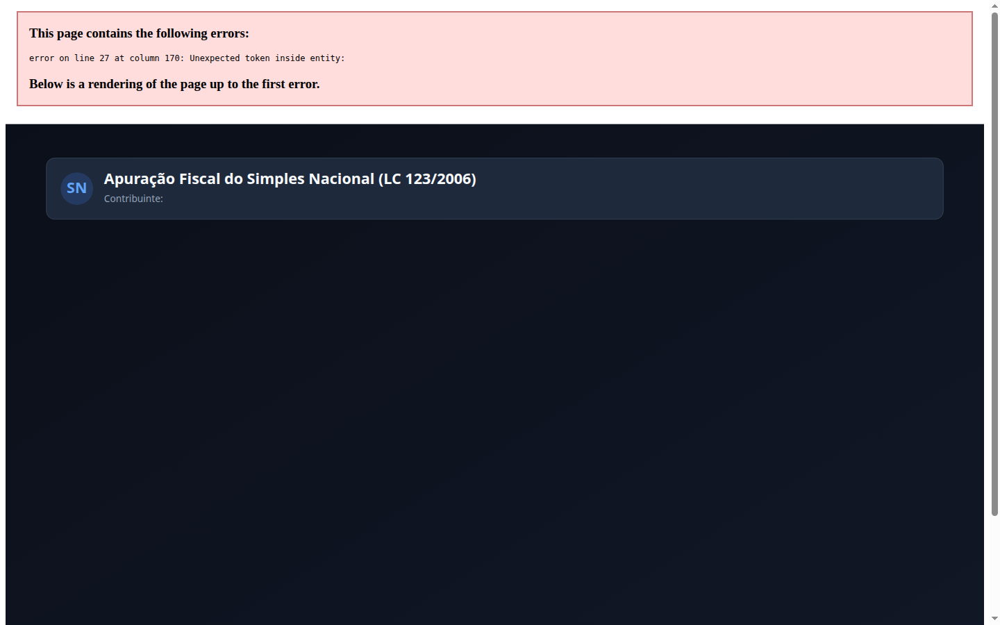

# Apuração do Simples Nacional (LC 123/2006)

[](https://github.com/martinlofranodeoliveira/apuracao-simples-nacional/actions)
[](https://www.python.org/)
[](LICENSE)
[-success.svg)](pyproject.toml)
[-green.svg)](src/apuracao_simples_nacional/calculator.py)
[](tools/verify_independent.py)

Motor determinístico, auditável e matematicamente exato para apuração mensal do **Simples Nacional** segundo a **Lei Complementar nº 123/2006** (atualizada pelas Leis Complementares nº 147/2014 e nº 155/2016) e resoluções do **Comitê Gestor do Simples Nacional (CGSN)**.

Desenvolvido segundo o padrão de engenharia fiscal e confiabilidade da **LOFRANO TECNOLOGIA**, este projeto não possui qualquer dependência externa (100% biblioteca padrão do Python), opera com **zero ponto flutuante** (`float`) através de representação em números inteiros (centavos) e frações racionais exatas (`fractions.Fraction`), e distribui cotas de tributos pelo algoritmo dos maiores restos (**Hare-Niemeyer / Hamilton**).

---

## 📸 Painel Executivo e Fiscal do Simples Nacional

O motor gera automaticamente painéis vetoriais em SVG (1440x900) e capturas em alta resolução documentando a Receita Bruta Total (RBT12), Folha Salarial (FS12), enquadramento dinâmico pelo Fator R, total do DAS a recolher e a partição de cada tributo federal, estadual e municipal:



---

## 🎯 Por Que Este Projeto Existe?

O Simples Nacional é o regime tributário de milhões de microempresas (ME) e empresas de pequeno porte (EPP) no Brasil. Entretanto, a apuração manual ou em planilhas eletrônicas frequentemente acarreta inconsistências graves:

1. **A Armadilha do Fator R**: Atividades intelectuais, de tecnologia da informação e consultoria transitam dinamicamente entre o **Anexo III** (alíquota inicial de $6\%$) e o **Anexo V** (alíquota inicial de $15{,}5\%$) dependendo da razão $F_R = \frac{\text{FS12}}{\text{RBT12}} \ge 28\%$. Pequenas variações de centavos na folha ou receita acumulada alteram drasticamente o imposto devido.
2. **A Fórmula Não-Linear da Alíquota Efetiva**: Desde 2018, a alíquota nominal de cada faixa não incide diretamente sobre o faturamento do mês. Aplica-se a fórmula de alíquota efetiva com dedução de parcela fixa:
   $$\text{Alíquota Efetiva} = \frac{(\text{RBT12} \times \text{Alíquota Nominal}) - \text{Parcela a Deduzir}}{\text{RBT12}}$$
   Calcular essa razão com ponto flutuante (`float`) introduz erros de truncamento em dízimas periódicas.
3. **Discrepâncias de Centavos na Partição de Tributos**: A guia única (DAS) arrecada até 8 tributos distintos (IRPJ, CSLL, PIS, COFINS, CPP, IPI, ICMS e ISS). A soma das quotas tributárias individuais deve fechar **com exatidão absoluta de centavos** no valor total do DAS apurado. Métodos ingênuos de arredondamento flutuante geram diferenças de centavos que causam rejeição em auditorias contábeis e declarações acessórias (DEFIS / PGDAS-D).
4. **Segregação de Receitas Multianexos**: Empresas mistas (que combinam comércio, indústria e prestação de serviços com ou sem Fator R) necessitam de enquadramento simultâneo em faixas independentes e consolidação auditável.

---

## 📐 Fundamentação Normativa (Lei Complementar 123/2006)

### 1. Fator R (Art. 18, §§ 5º-J e 5º-M)

$$F_R = \frac{\text{FS12}}{\text{RBT12}}$$

- Se $F_R \ge \frac{28}{100}$ ($28\%$): a atividade de serviços enquadra-se no **Anexo III** (tributação reduzida).
- Se $F_R < \frac{28}{100}$: a atividade de serviços é tributada pelo **Anexo V**.

### 2. Tabela Resumo dos Anexos da LC 123/2006

| Anexo | Campo de Aplicação | Alíquota Faixa 1 | Alíquota Faixa 6 | Tributos Inclusos no DAS |
|:---:|---|:---:|:---:|---|
| **Anexo I** | Comércio Varejista e Atacadista | $4{,}00\%$ | $19{,}00\%$ | IRPJ, CSLL, COFINS, PIS, CPP, ICMS |
| **Anexo II** | Indústria e Fabricação | $4{,}50\%$ | $30{,}00\%$ | IRPJ, CSLL, COFINS, PIS, CPP, IPI, ICMS |
| **Anexo III** | Serviços em Geral / Fator R $\ge 28\%$ | $6{,}00\%$ | $33{,}00\%$ | IRPJ, CSLL, COFINS, PIS, CPP, ISS |
| **Anexo IV** | Obras, Advocacia, Limpeza e Vigilância | $4{,}50\%$ | $33{,}00\%$ | IRPJ, CSLL, COFINS, PIS, ISS *(CPP fora do Simples)* |
| **Anexo V** | Serviços Intelectuais / Fator R $< 28\%$ | $15{,}50\%$ | $30{,}50\%$ | IRPJ, CSLL, COFINS, PIS, CPP, ISS |

### 3. Partição de Tributos pelo Método dos Maiores Restos (Hare-Niemeyer)

Para garantir que a soma dos centavos de cada tributo feche rigorosamente no total do DAS calculado para a atividade:
1. Calcula-se a quota racional exata de cada tributo $i$: $c_i = \frac{V_{DAS} \cdot p_i}{q_i} \in \mathbb{Q}$.
2. Atribui-se a cada tributo sua parte inteira truncada: $v_i = \lfloor c_i \rfloor$.
3. Calcula-se o saldo residual de centavos: $K = V_{DAS} - \sum v_i$.
4. Ordenam-se os tributos pelo maior resto racional $(c_i - \lfloor c_i \rfloor)$, com critério de desempate determinístico lexicográfico estável.
5. Os primeiros $K$ tributos recebem $+1$ centavo, garantindo fechamento perfeito: $\sum_{i=1}^{n} v_i = V_{DAS}$.

---

## 🛡️ Padrão de Engenharia e Integridade LOFRANO TECNOLOGIA

- **Zero Float**: Ausência absoluta de `float`. Toda a base monetária opera em centavos inteiros (`int`) e taxas em frações racionais irredutíveis (`fractions.Fraction`).
- **Zero Dependências**: Executável em qualquer ambiente Python 3.11+ sem dependências de terceiros (`json`, `argparse`, `fractions`, `pathlib`, `sqlite3`, `zipfile`, `unittest`).
- **Codec JSON Canônico e Seguro**: Rejeita Byte Order Mark (BOM), números float na leitura, chaves duplicadas e profundidade de aninhamento excessiva (> 32).
- **Proteção Contra Injeção de Fórmulas em Planilhas**: Planilhas CSV geradas sanitizam prefixos perigosos (`=`, `+`, `-`, `@`, `\t`, `\r`) para evitar ataques de CSV/DDE injection no Excel e LibreOffice Calc.
- **Auditor Independente em SQLite (`tools/verify_independent.py`)**: Script desacoplado que carrega as tabelas da LC 123/2006 em banco em memória e refaz os cálculos relacionais sem importar nenhum arquivo da aplicação.

---

## 🚀 Instalação e Execução

### Instalação Local
```bash
git clone https://github.com/martinlofranodeoliveira/apuracao-simples-nacional.git
cd apuracao-simples-nacional
python3 -m pip install .
```

### Comandos da Linha de Comando (CLI)

#### 1. Gerar Modelo de Entrada Canônico
```bash
simples-nacional exemplo --saida minha_empresa.json
```

#### 2. Executar Apuração Mensal no Terminal
```bash
simples-nacional apurar exemplares/empresa_mista_comercio_servicos.json
```

#### 3. Gerar Pasta Completa de Relatórios Fiscais (CSV, JSON, Markdown, SVG)
```bash
simples-nacional apurar exemplares/empresa_mista_comercio_servicos.json --saida relatorios_fiscais/
```

#### 4. Gerar Pacote ZIP Determinístico Consolidado
```bash
simples-nacional apurar exemplares/empresa_mista_comercio_servicos.json --zip apuracao_completa.zip
```

---

## 🧪 Suíte de Testes e Auditoria

Execução dos 64 testes unitários automatizados:
```bash
python3 -m unittest discover -s tests -v
```

Execução do auditor independente desacoplado em SQLite:
```bash
python3 tools/verify_independent.py exemplares/empresa_mista_comercio_servicos.json
```

---

## 📄 Licença

Distribuído sob a licença **MIT**. Consulte o arquivo [LICENSE](LICENSE) para mais detalhes.
